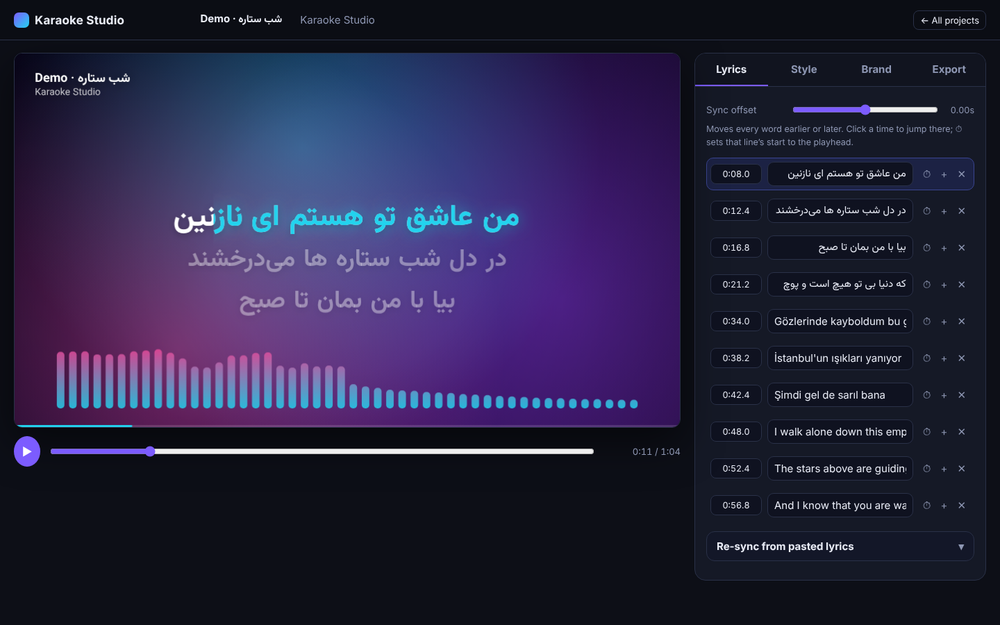
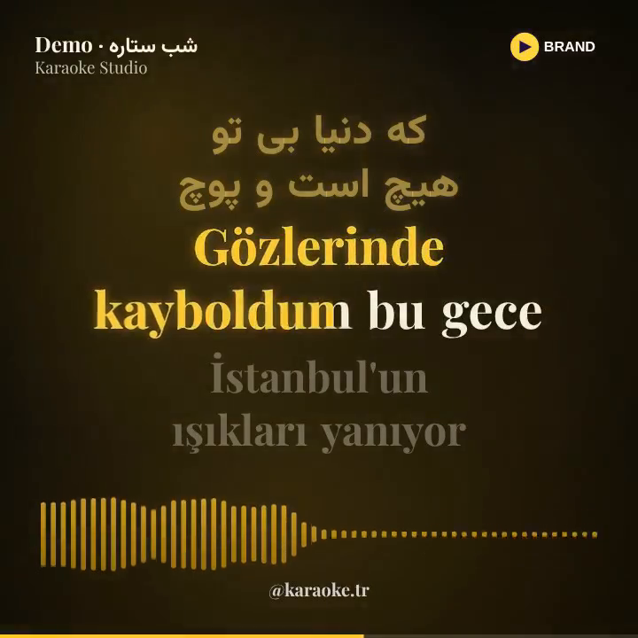

# Karaoke Studio

Upload a song → get a **karaoke MP4**: vocals removed, lyrics highlighted **word by word**, with your own fonts, colors, background, logo and an audio-reactive visualizer.

Persian (فارسی), English and Turkish (Türkçe) are first-class: Persian letters join correctly, the highlight sweeps right-to-left across Persian words, and Turkish `İ ı ş ğ` are handled everywhere (including UPPERCASE).

<p align="center">
  
</p>
<p align="center">
  
</p>

Everything runs **on your own computer**. Nothing is uploaded anywhere; the only network use is the one-time download of the AI models.

## Install

You need **Python 3.10+** and **ffmpeg** (`brew install ffmpeg` · `sudo apt install ffmpeg` · `winget install ffmpeg`).

```bash
git clone https://github.com/farzadkarkhani/karaoke.git && cd karaoke
python -m venv .venv && source .venv/bin/activate      # Windows: .venv\Scripts\activate
pip install -e .
playwright install chromium                              # the browser that draws the video frames
```

> **No GPU?** On Linux, pip downloads a very large CUDA build of PyTorch by default. Install the small CPU one first:
> `pip install torch torchaudio --index-url https://download.pytorch.org/whl/cpu`

## Use

```bash
python -m karaoke          # opens http://127.0.0.1:8000
```

1. **Drop a song**, choose the language, and (strongly recommended) **paste the lyrics**.
2. Wait while it removes the vocals and listens to the words. The first run downloads the models (~1–2 GB total); later songs are much faster.
3. In the **studio**, press play. Fix any lyric or timing, then style it in the **Style** and **Brand** tabs; the preview is exactly what gets rendered.
4. **Export** → pick the format (16:9, 9:16, 1:1, 4:5) and press **Render MP4**.

Several songs? Pick or drop them all at once. Not sure yet? Press **Try the demo** on the home page: no upload, no models, ready in a second.

### Preview, shortcuts and fullscreen

Before you press play the preview shows a **cover card**: the song title big in the middle with the artist below (it is also the first frame of the exported video; switch it off in **Brand → Title & artist**).

| Key | Action |
|---|---|
| `Space` / `K` | Play · pause (clicking the preview does the same) |
| `←` `→` | Seek 5 s back · forward (`Shift` = 15 s) · `J` `L` = 10 s |
| `[` `]` | Previous · next lyric line · `Home` restart |
| `↑` `↓` | Guide vocal louder · quieter (0–50 %, 5 % steps) · `G` guide on/off |
| `F` or double-click | **Fullscreen**: just the video picture, no controls, the mouse pointer hides itself · `Esc` exits |
| `?` | Show the shortcut list |

Shortcuts are ignored while you type in a text box. They also work in fullscreen.

### Projects and disk space

There is **no limit on the number of projects**; only your disk. The home page lists every project as a card (title, artist, length, language, size, status) with a search box, and shows how much disk space they use. You can drop **several songs at once** (for example 30): they are queued and processed one after another, and the cards fill in as each finishes.

What a project costs on disk (measured, for a 4-minute song):

| What | Size |
|---|---|
| Project itself (original file, vocals and instrumental as WAV, preview MP3s) | about **100 MB** |
| Each exported 1080p MP4 (Standard quality) | about **135 MB** (Draft / 720p: roughly 15–40 MB) |
| AI models, downloaded once and shared by all projects | about 2–3 GB |

So **30 projects ≈ 3 GB**, or about **7 GB** if each also keeps one 1080p export. Delete an old export with the ✕ next to it in **Export → Earlier exports**, or a whole project with the ✕ on its card, to free the space.

### Getting accurate word timing

| Situation | What to do |
|---|---|
| Any song | **Paste the lyrics.** Your text is kept exactly (spelling, line breaks); only the *timing* comes from the audio. Matching tolerates mis-heard words and Persian/Turkish spelling variants. |
| Language guessed wrong | Choose the language on the home page, or use **Lyrics → Re-run recognition** (vocal removal is kept). |
| Persian or Turkish song | Use the **Best** recognition model (default). The smaller ones are noticeably worse at singing in these languages. |
| One line drifts | Play the song, and press **⏱** on that line at the right moment, or drag **Sync offset** to shift everything. |
| Missing or wrong words | Edit the text in the Lyrics tab, or paste corrected lyrics and press **Re-sync to audio**. |

### Branding and style

* **Look**: six built-in looks, plus **Save as preset** to keep *your* brand (colors, fonts, logo, footer) and apply it to every song.
* **Background**: gradient, solid color, or your image (with dim, blur and a slow push-in), animated color glow that breathes with the bass.
* **Lyrics**: font, weight, size, spacing, text/highlight color, glow, shadow, outline, sweep or whole-word highlight, how many lines are visible, UPPERCASE.
* **Visualizer**: bars, centered bars, wave, or a ring behind the lyrics; colors, height, position, sensitivity.
* **Brand**: logo (PNG/JPG/SVG) in any corner, footer/handle text, title and artist, intro title card, countdown dots before lyrics, progress bar, and **your own font** (TTF/OTF/WOFF).
* **Export**: 720p / 1080p / 1440p (short side), 24 / 30 / 60 fps, draft / standard / high quality, optional quiet **guide vocal** for learning the song.

Bundled fonts (all SIL OFL): Vazirmatn, Inter, Montserrat, Poppins, Playfair Display, Lalezar, Noto Naskh Arabic. Fonts without Arabic letters fall back to Vazirmatn for Persian words.

## Command line

No browser needed:

```bash
python -m karaoke.cli make song.mp3 --lang fa --lyrics lyrics.txt --preset gold --aspect 9:16 -o song.mp4
python -m karaoke.cli demo --preset ocean -o demo.mp4
```

Run `python -m karaoke.cli make --help` for all options (`--asr`, `--separation`, `--fps`, `--quality`, `--guide`, `--style file.json`, …).

## Speed

Measured on a 4-core CPU with no GPU (a 32-second test clip and a 65-second video; real songs vary, but scale roughly linearly):

| Step | Measured | So a 4-minute song takes about |
|---|---|---|
| Vocal removal (Demucs `fast`) | 14.6 s for 32 s of audio (≈ 0.45× song length) | 2 min |
| Lyrics recognition, `Best` model (large-v3-turbo) | 7 s for 32 s, including model load (≈ 0.2×) | 1 min |
| MP4 export, 1080p / 30 fps / Standard | 79 s for a 65 s video (≈ 1.2×) | 5 min |

Export time is dominated by 1080p H.264 encoding plus frame drawing, both CPU-bound. Draft quality and 720p are noticeably faster. The AI steps use a CUDA GPU automatically when one is present.

## How it works

```
song ─ffmpeg→ wav ─Demucs→ vocals + instrumental ─faster-whisper (word timestamps)→ recognised words
                                                                       │
                       your pasted lyrics ──fuzzy sequence alignment───┘→ timed lines (editable)

studio preview  ┐                                       instrumental (+ guide vocal)
                ├─ renderer.js: draw(t) on a canvas ──┐             │
MP4 export      ┘   (same code, headless Chromium)    └→ ffmpeg → H.264 + AAC .mp4
```

* `karaoke/align.py`: the interesting part. Aligns recognised words to your lyrics with a global sequence alignment, folds Persian/Arabic and Turkish spelling variants for matching only, and interpolates words the recogniser missed.
* `karaoke/static/renderer.js`: one deterministic `draw(t)`; the browser's own text engine does Persian shaping and bidi.
* Frames are rendered by several headless-Chromium pages in parallel and streamed into ffmpeg.

## Limitations (honest list)

* Word timing is only as good as the recogniser. Singing is harder than speech, and Persian singing is the hardest of the three: expect to fix a line here and there, which is why pasting lyrics matters.
* Vocal removal is AI-based: some backing vocals or reverb may remain, and a little of the music may be removed with the voice.
* Mixed-script lines (e.g. a Persian line with a whole English phrase) keep logical word order and may not follow strict bidi reordering inside the line.
* No video backgrounds yet (colors, gradients and images only). The studio UI is in English.
* It is a single-user local app with no login. Do not expose it to the internet (`--host 0.0.0.0` is for your own network).
* Only use music you have the rights to.

## Troubleshooting

| Message | Fix |
|---|---|
| `ffmpeg was not found` | Install ffmpeg and make sure `ffmpeg -version` works in the same terminal. |
| `Could not start the headless browser` | Run `playwright install chromium`, or set `KARAOKE_CHROMIUM` to the path of Chrome/Chromium/Edge. |
| `Could not download an AI model` | The first run needs internet (models come from Hugging Face and the Demucs servers). Retry; they are cached afterwards. |
| Persian looks disconnected / boxes appear | Make sure you did not remove `karaoke/static/fonts`; for a brand font without Arabic letters, Vazirmatn is used as fallback. |

## Development

```bash
pip install -e ".[dev]" && pytest            # alignment + API tests (no models or browser needed)
python scripts/build_fonts.py                 # re-fetch the bundled fonts from npm (@fontsource)
python scripts/make_test_songs.py /tmp/songs  # fa/tr/en test songs with known timings (needs espeak-ng)
```

Data (projects, uploads, renders, presets) is kept in `./data`; set `KARAOKE_DATA` or pass `--data` to move it. Delete a project in the UI (or its folder) to reclaim disk space.

## Licenses

No project license has been chosen yet; add a `LICENSE` file before sharing it. Bundled fonts: SIL Open Font License 1.1 (see `karaoke/static/fonts/LICENSE-*.txt`). Uses [Demucs](https://github.com/facebookresearch/demucs) (MIT), [faster-whisper](https://github.com/SYSTRAN/faster-whisper) and OpenAI Whisper models (MIT), [Playwright](https://playwright.dev) (Apache-2.0), FastAPI, ffmpeg.
